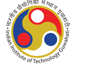

# Indian Institute of Technology Guwahati
## B.Tech Project (BTP) Supervisor Certificate

---

### **Indian Institute of Technology Guwahati**

## **Certificate**

 

This is to certify that **Mr. Sarvagya Tiwari (Roll No. 230122047)** has been working under my supervision as a Project Student in my research group since July 2025.

His project, entitled **“Wearable AI for Insulin Resistance Screening”**, is being forwarded for submission. I hereby certify that he has satisfactorily completed all the requirements in accordance with the rules and regulations of the Institute pertaining to the conduct of such investigations.

To the best of my knowledge, the results presented in this project report have not been submitted elsewhere for the award of any degree.

   

<table style="width: 100%; border: none;">
  <tr style="border: none;">
    <td style="width: 55%; border: none; vertical-align: top;">
      <strong>Prof. Ritika Jain</strong> 
      Indian Institute of Technology Guwahati 
      e-mail: rjain1992@iitg.ac.in  
      <strong>Date:</strong> May 2026
    </td>
    <td style="width: 45%; border: none; vertical-align: bottom; text-align: center;">
         
      ____________________________________ 
      <strong>Signature of Supervisor</strong>
    </td>
  </tr>
</table>

---

## Curated List of Short, Impactful Titles

| Length | Title | Highlights / Style |
| :---: | :--- | :--- |
| **6 words** | **“Wearable AI for Insulin Resistance Screening”** | **(Recommended)** Precise, crisp, and high-impact. |
| **5 words** | **“Wearable Insulin Resistance Screening”** | Pure, minimalist, clinical focus. |
| **5 words** | **“Wearable AI for Metabolic Screening”** | Broader scope encompassing prediabetes & metabolic health. |
| **6 words** | **“Non-Invasive Wearable Insulin Resistance Screening”** | Emphasizes zero-blood non-invasive modality. |
| **5 words** | **“Continuous Wearable Metabolic Health Intelligence”** | Product and continuous sensing focus. |

---

## File Formats Generated
* **Word Document (Updated Short Title):** [`IITG_BTP_Certificate_ShortTitle.docx`](file:///d:/BTP/IITG_BTP_Certificate_ShortTitle.docx)
* **LaTeX Thesis Template:** [`IITG_BTP_Certificate_Sarvagya_Tiwari.tex`](file:///d:/BTP/IITG_BTP_Certificate_Sarvagya_Tiwari.tex)
* **High-Resolution IITG Emblem:** [`iitg_logo.png`](file:///d:/BTP/iitg_logo.png)
